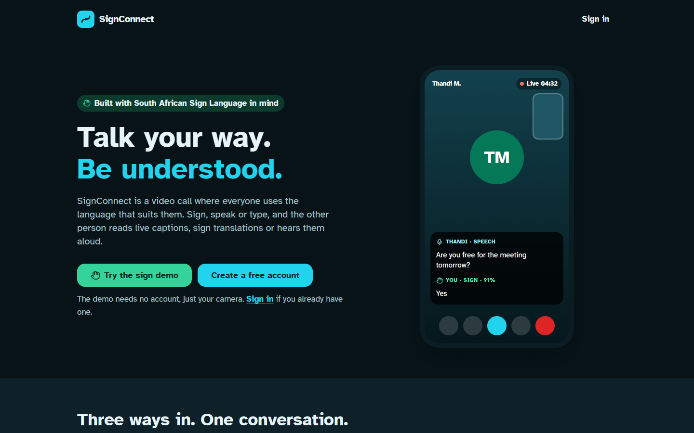
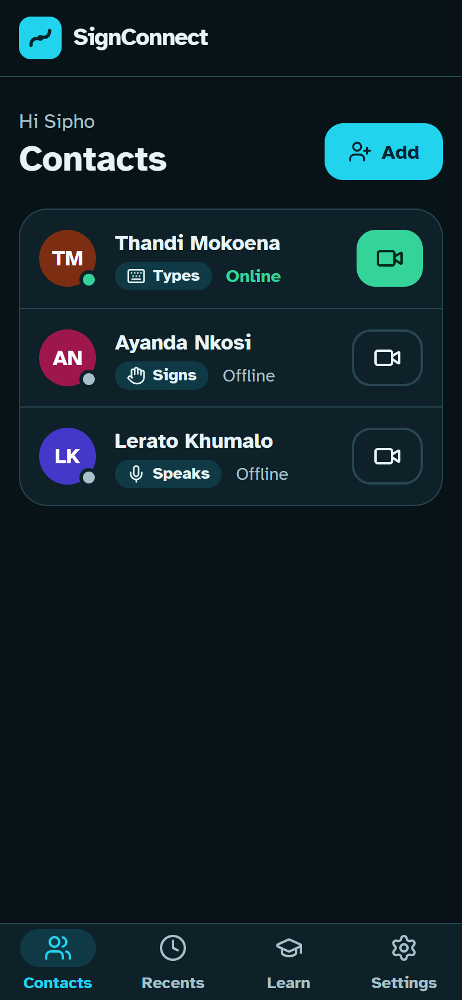
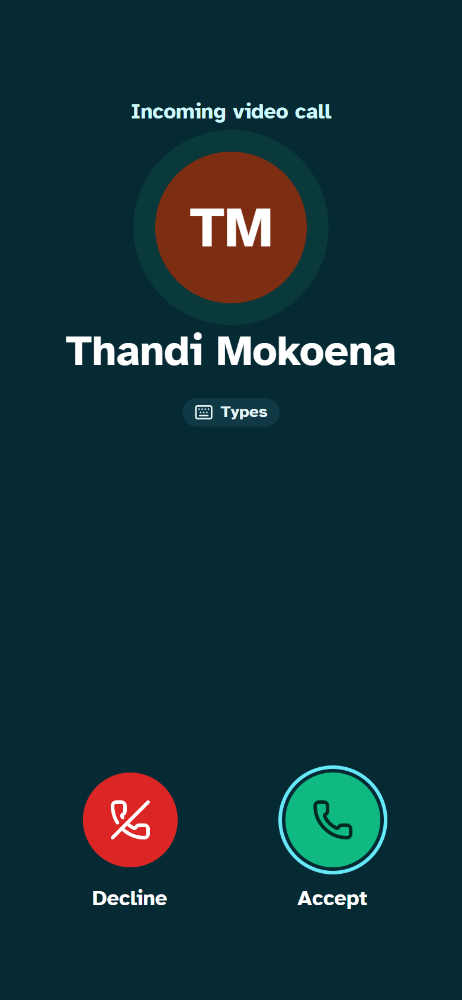
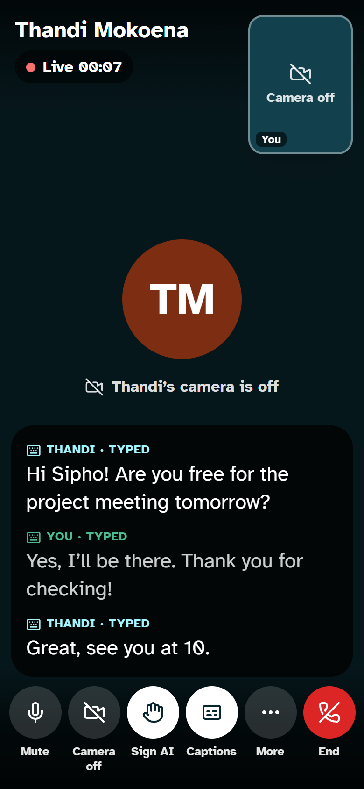
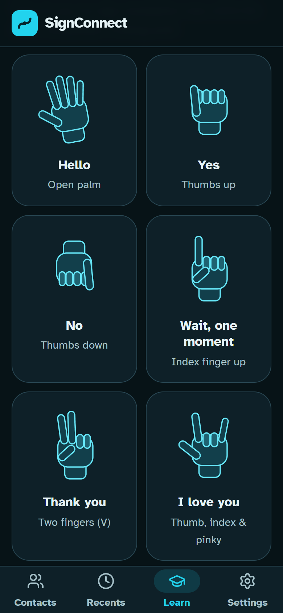
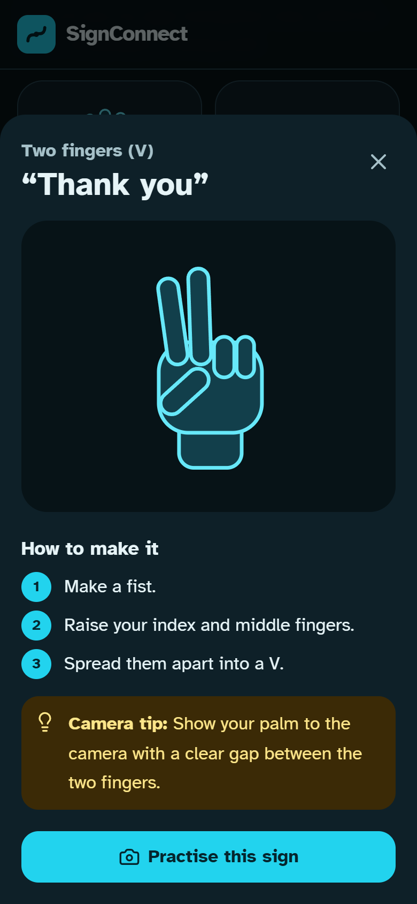
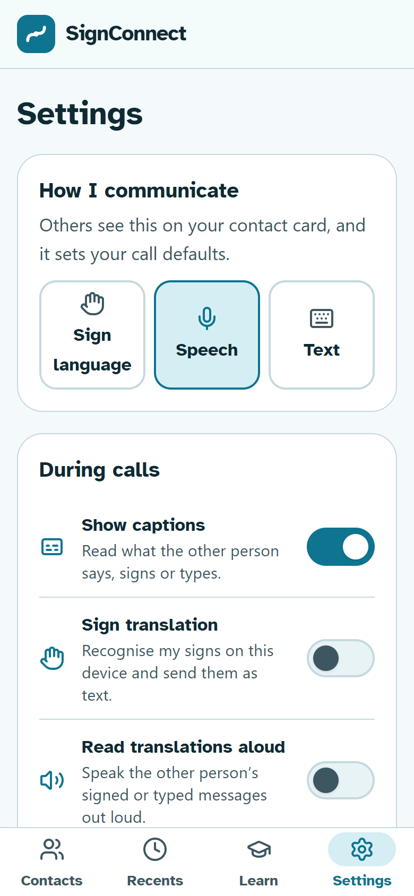
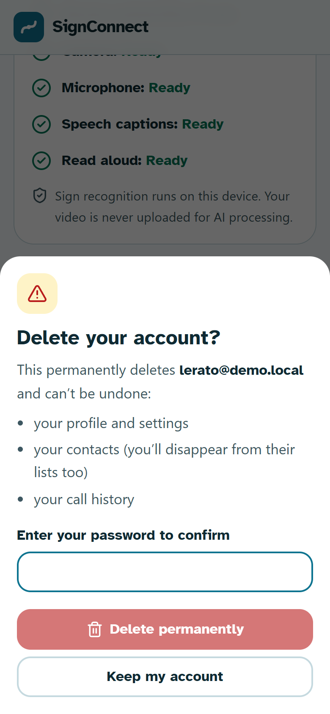
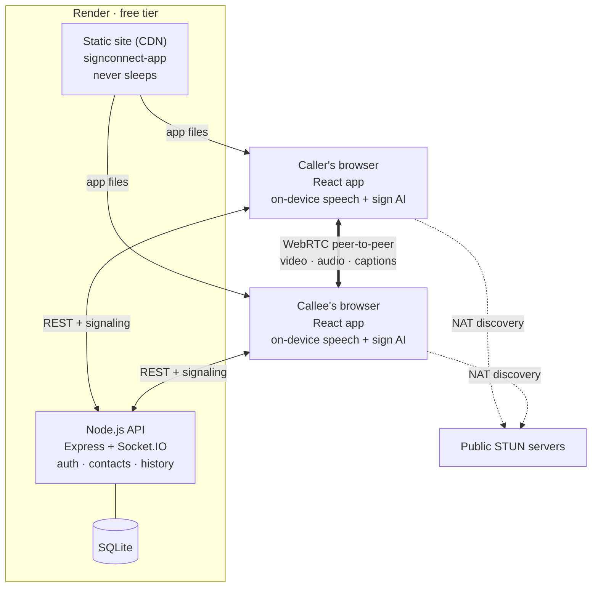
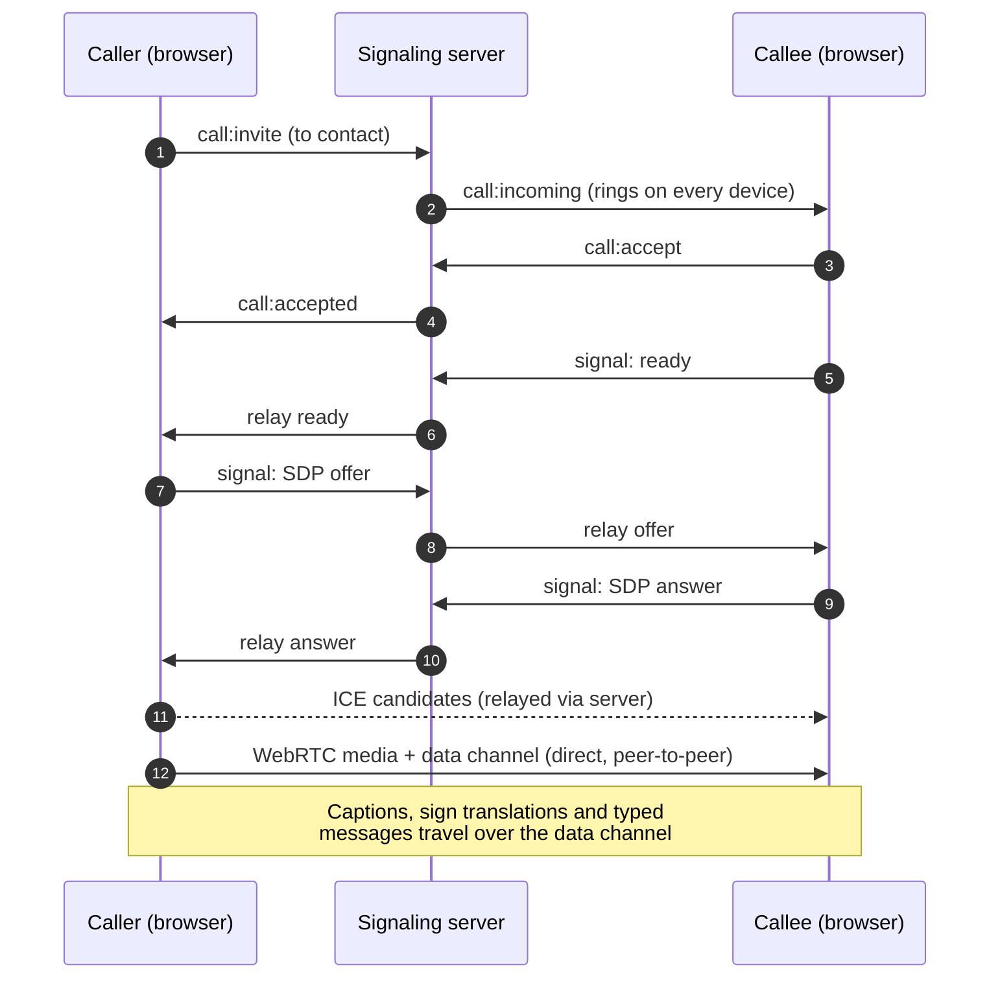

# SignConnect

**Real-time accessible video calling: sign, speak or type, and be understood.**

Each person in a call chooses how they communicate. Speech becomes live captions, hand signs
are recognised on-device and sent as text (or read aloud), and typed messages appear as
captions. It's built with South African Sign Language (SASL) in mind.

### ▶ Live demo: **[signconnect-app.onrender.com](https://signconnect-app.onrender.com/)**

> Tap **Try the sign demo** to see on-device sign recognition with your camera, no account
> needed. To try a call, create two accounts (e.g. phone + laptop), add each other as
> contacts, and call. The API runs on free hosting, so the first request after a quiet
> spell can take up to a minute; the app tells you when that happens.

---

## Screenshots

| Landing page |
|---|
|  |

| Contacts | Incoming call | In a call |
|---|---|---|
|  |  |  |

| Learn signs | Sign lesson | Settings | Delete account |
|---|---|---|---|
|  |  |  |  |

## Features

- **1-to-1 video calls** over WebRTC (peer-to-peer), with multi-device ringing, vibration
  and a flashing tab title for incoming calls, and call history.
- **Live speech captions.** The speaker's browser transcribes their speech (South African
  English) and streams interim results to the other person while they talk.
- **Sign recognition, on-device.** MediaPipe tracks the hands in the browser and recognised
  signs are sent as captions with a confidence bar. Low-confidence results are shown as
  "Possibly: …" rather than presented as fact.
- **Typed messages and read-aloud.** Type mid-call; sign and typed messages can be spoken
  aloud for hearing participants.
- **Learn & practise.** Animated hand-shape lessons (SVG + Motion) and a camera practice
  mode that confirms when a sign is recognised.
- **Accessible by design.** WCAG AA contrast, Atkinson Hyperlegible font, three caption
  sizes, 44 px+ touch targets, keyboard and screen-reader support, reduced-motion support,
  and light/dark themes.
- **Works without a camera.** Devices with no camera join calls receive-only.
- **Account control.** Users can permanently delete their account, contacts and call
  history from Settings (password-confirmed).

## Architecture



**Key design decision:** the server never touches media or captions. It handles accounts
and signaling only; video, audio and caption text flow directly between the two browsers.
Speech and sign recognition run on each user's own device, so camera video is never uploaded
for AI processing. That gives lower latency, better privacy and near-zero server cost.

### How a call is set up



## Tech stack

| Layer | Technology |
|---|---|
| Frontend | React 18, Vite, Tailwind CSS v4, React Router, Motion, Lucide icons |
| Real-time | WebRTC (media + data channel), Socket.IO (signaling, presence) |
| On-device AI | MediaPipe Tasks Vision (gesture recognition), Web Speech API (captions), Speech Synthesis (read-aloud) |
| Backend | Node.js 22, Express, Socket.IO, `node:sqlite`, bcrypt, JWT |
| Hosting | Render Blueprint: static site (CDN) + web service, both free tier |
| Design | Design system generated with the ui-ux-pro-max skill ([`MASTER.md`](design-system/signconnect/MASTER.md)) |

## Run it locally

Requires Node 22.13+.

```bash
npm install
npm run dev          # API on :4010 + app on http://localhost:5180
```

A laptop without a camera still works: it joins calls receive-only.

### Test on your phone (same Wi-Fi)

Phones only allow camera and microphone access over **HTTPS**:

```bash
npm run dev:https
```

Open the `Network: https://192.168.x.x:5180` URL Vite prints, accept the self-signed
certificate warning, sign up and allow camera + mic. Use a second account on the laptop to
call the phone. If Windows Firewall asks, allow Node on private networks.

## Deploy (free)

`render.yaml` is a Render Blueprint with two free services:

| Service | Role | Why |
|---|---|---|
| `signconnect-app` (static site) | The app people visit | Served from a CDN and never sleeps, so it loads instantly |
| `signconnect` (web service) | API + signaling | Free instances sleep when idle and take up to a minute to wake |

On load the app pings `/api/health` and shows a "Waking up the demo server…" notice only if
the API is asleep. `/demo` needs neither an account nor the server.

The services reference each other's public URLs: `VITE_API_URL` on the static site and
`CLIENT_ORIGINS` (CORS allow-list) on the API. Update both in `render.yaml` if yours differ.

- **SQLite on the free tier is wiped on each redeploy.** Fine for a demo; use a persistent
  disk or PostgreSQL for real use.
- **Mobile data:** free public STUN servers connect most networks directly. Some strict
  mobile networks need a TURN relay, which you can add via `ICE_SERVERS` (JSON) without code changes.

## Project structure

```
client/src/
  lib/calls.jsx              socket, presence, call state machine
  lib/serverStatus.jsx       wakes the API and reports "waking up" status
  lib/signVocabulary.js      sign content: handshapes, steps, planned SASL modules
  hooks/useLocalMedia.js     camera/mic with graceful fallback (A+V → audio → none)
  hooks/useWebRTC.js         peer connection, captions data channel, ICE restart
  hooks/useSpeechCaptions.js Web Speech API captions (en-ZA), auto-restart
  hooks/useSignRecognition.js MediaPipe gestures, stabilised over 10 frames
  components/HandSign.jsx    parametric animated SVG hand
  pages/                     Landing, Auth, Contacts, Recents, Learn, Practice, Call, Settings
server/src/
  signaling.js               invite/accept/decline/end, ring timeout, SDP/ICE relay
  routes/                    auth (incl. account deletion), contacts, history, preferences
  db.js                      schema (portable SQL, PostgreSQL-ready)
```

## Honest limits

- The current sign vocabulary is **general hand gestures, not SASL** (open palm = "Hello",
  thumbs up = "Yes", …). It demonstrates the pipeline while a proper SASL vocabulary is built.
- Speech captions depend on browser support (Chrome, Edge, Safari; not Firefox). Some Android
  devices can't run speech recognition and a WebRTC call on the microphone at the same time.

## Roadmap

| Phase | What | Status |
|---|---|---|
| 1 | Accounts, contacts, accessibility preferences | ✅ Done |
| 2 | 1-to-1 WebRTC video calls | ✅ Done |
| 3 | Live speech → captions | ✅ Done |
| 4–5 | Sign → text during calls | 🟡 Preview (demo gestures, on-device) |
| 6 | Text → speech | ✅ Done |
| 7 | SASL dataset (consent-based landmark recording) + custom model, signer-video lessons | ⏳ Next |

## License

[MIT](LICENSE). Free to use, modify and share, with attribution.
